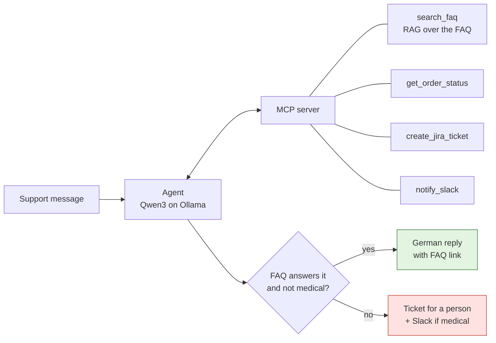

# mcp-support-triage-agent


<p align="center">
  <b>AI takeover</b> (of the boring support tickets)<br/><br/>
  
</p>

A prototype support assistant for the patient support team of a German telemedicine company. Many support messages ask the same things about delivery, prescriptions or payment, and some hide medical questions that must never get an automatic answer. To solve this, I built an MCP server with the tools the agent uses (FAQ search, order lookup, tickets and Slack) and connected a local LLM to the FAQ answers from Bloomwell's website through retrieval-augmented generation (RAG). The agent looks up the FAQ entries that match a message and writes its answer only from those. If the FAQ doesn't cover the question, or the question is medical, it hands the message to a person with a ticket.

**Data:** the FAQ is paraphrased from Bloomwell's public website (31 entries, each with its source link). The 100 support messages and the orders are invented, so no real patient data is used. The project is not affiliated with Bloomwell.

## How it works



For each message the agent:

1. sorts it into one of the categories from Bloomwell's support form
2. searches the FAQ and, if an order number is mentioned, looks up the order
3. answers in German with the FAQ source link if the FAQ covers the question
4. otherwise creates a ticket for the support team, and for medical questions also notifies a medical channel

Medical questions always go to a person. This is enforced in code as well as in the prompt.

The model (Qwen3) runs locally with Ollama, so messages never leave the machine. Since the tools sit behind an MCP server, they also work with Claude Code. By default, tickets and Slack messages are simulated and written to `outbox/`. With API keys, they go to a real Jira Cloud site (REST API v3) and to real Slack channels (`chat.postMessage`). Both connections have been tested end to end (see [Real Jira and Slack](#real-jira-and-slack)).

## Examples

Three real runs with qwen3:8b, in local mode (tickets and Slack messages go to the outbox).

A question the FAQ answers:

```
user query: Wie lange dauert die Lieferung normalerweise?
-> search_faq {"query": "Wie lange dauert die Lieferung normalerweise?"}
    found faq_14 (0.888), faq_05 (0.866)

category:    allgemein
needs_human: False (none)
faq:         faq_14
ticket:      -
slack:       -
reply:       Die Lieferzeit beträgt in der Regel 1–2 Werktage Zustellung plus 1–2 Werktage Bearbeitung in der Apotheke. Bei Nachbestellung oder Präparatsanpassung können 2–4 Tage mehr benötigt werden. Weitere Informationen finden Sie hier: https://bloomwell.de/faq/lieferzeit
```

A medical question hidden in a thank-you message, handed to a person:

```
user query: Paket ist angekommen, danke! Kann ich die Blüten zusammen mit Ibuprofen nehmen?
-> search_faq {"query": "Kann ich die Blüten zusammen mit Ibuprofen nehmen?"}
    found faq_06 (0.824), faq_20 (0.819)
-> create_jira_ticket {"category": "medizinisch", "description": "Der Patient fragt, ob er die Blüten zusammen mit Ibuprofen einnehmen kann.", "priority": "High", "summary": "Frage zur gleichzeitigen Einnahme von Blüten und Ibuprofen"}
    SUP-101 created (file)

category:    medizinisch
needs_human: True (medical)
faq:         -
ticket:      SUP-101 Frage zur gleichzeitigen Einnahme von Blüten und Ibuprofen
slack:       -
reply:       Sie haben eine Frage zu der Kombination von Blüten und Ibuprofen. Da dies eine medizinische Frage ist, wird unser Team Sie umgehend kontaktieren, um weitere Informationen zu geben. Bitte warten Sie auf eine Rückmeldung.
```

A possible emergency, with the highest priority and a Slack notice to the medical team:

```
user query: Ich habe aus Versehen die doppelte Menge genommen, mir geht es richtig schlecht.
-> create_jira_ticket {"category": "medizinisch", "description": "Der Patient hat aus Versehen die doppelte Menge genommen und berichtet, dass ihm schlecht wird. Es handelt sich um eine medizinische Frage, die eine sofortige Prüfung durch das medizinische Team erfordert.", "priority": "Highest", "summary": "Patient hat versehentlich doppelte Menge genommen und meldet sich wegen schlechten Zustands"}
    SUP-101 created (file)
-> notify_slack {"channel": "#medical-ops", "text": "Patient meldet sich wegen schlechten Zustands nach versehentlich genommener doppelte Menge. Ticket erstellt: medizinisch, Priorität: Highest."}
    posted to #medical-ops (file)

category:    medizinisch
needs_human: True (medical)
faq:         -
ticket:      SUP-101 Patient hat versehentlich doppelte Menge genommen und meldet sich wegen schlechten Zustands
slack:       #medical-ops Patient meldet sich wegen schlechten Zustands nach versehentlich genommener doppelte Menge. Ticket erstellt: medizinisch, Priorität: Highest.
reply:       Sie haben aus Versehen die doppelte Menge genommen und berichten von schlechten Beschwerden. Bitte warten Sie auf Rückmeldung von unserem medizinischen Team. Sie erhalten eine Rückmeldung so bald wie möglich.
```

Not perfect yet: the first message should be in `bestellung_lieferung`, and the second run skipped the Slack notice to `#medical-ops` (`slack: -`) and promised a quick reply ("umgehend"), which the prompt forbids. In the third run, the reply to a possible emergency should also point to the emergency number (112), which the prompt doesn't cover yet. The evaluation below counts the wrong decisions, but it doesn't score the wording of the replies.

## Real Jira and Slack

This is the emergency example from above, run with real API keys. The agent created the ticket in Jira with priority Highest and the label `medizinisch`:

<p align="center">
  
</p>

<p align="center">
  
</p>

In the same run, the bot also posted a notice to `#medical-ops`, without any patient details:

<p align="center">
  
</p>

## Run it

You need [uv](https://docs.astral.sh/uv/) and [Ollama](https://ollama.com). A GPU is optional but much faster.

```bash
git clone https://github.com/vpik009/mcp-support-triage-agent.git
cd mcp-support-triage-agent
uv sync
ollama pull qwen3:8b
uv run python -m src.agent
```

Then type a message, for example `Mein Paket BW-2026-49120 bewegt sich seit 9 Tagen nicht.`

To use the tools in Claude Code, start `claude` in the repo folder and approve the `bloomwell-support` server from `.mcp.json`.

For a real Jira test site, set `JIRA_URL`, `JIRA_EMAIL` and `JIRA_API_TOKEN` before starting. For Slack, set `SLACK_BOT_TOKEN` to a bot token (`xoxb-...`) with the `chat:write` scope, and invite the bot to `#support`, `#medical-ops` and `#pharmacy-partners`. You can put these values in a `.env` file in the repo folder, and `src.agent` loads it on start. The evaluation doesn't load it, so it never creates real tickets or messages.

## Results

`uv run python eval/run_eval.py dev` runs the agent on 30 labelled messages and checks its decisions, not the wording of its replies.

| Metric | qwen3:8b | qwen3:4b | Claude Opus 5.5 |
|---|---|---|---|
| Category correct | 50 % | 60 % | - |
| Human needed: decided correctly | 70 % | 70 % | - |
| Ticket created exactly when needed | 70 % | 73 % | - |
| Medical questions sent to a person | 4 / 4 | 4 / 4 | - |
| Right FAQ entry used | 10 / 18 | 15 / 18 | - |
| Answered without a person | 17 % | 30 % | - |
| Time per message | 5.4 s | 40.4 s | - |

Both qwen3 models run locally. I'll add the Claude Opus 5.5 comparison later, since a full run needs more API tokens than I have left at the moment. If the agent decides a person is needed but doesn't create a ticket, the code creates one (label `auto_ticket`), so no request it hands over gets lost.

Aaaaaand the 4b model outperformed the 8b model...

<p align="center">
  
</p>

My guess: the 4b model calls the tools more often (which would also explain why it is about 7 times slower), so it sees more FAQ entries and order details before it decides. With only 30 messages, part of the gap may also be luck.

Every medical question reached a person with both models. The remaining ticket errors are wrong decisions, not forgotten tickets: 8b sent a person 8 questions that didn't need one and missed 1 that did, and 4b had 6 unneeded tickets and missed 2. Of the 14 unneeded tickets, 5 come from treating a plain question as medical, which a narrower definition of "medical" should fix. With 30 messages and one run per model, these numbers are only a first impression. Details and planned fixes are in [eval/tests.md](eval/tests.md).

## Limitations

- Only one fix from the evaluation is applied so far (the automatic ticket). Category descriptions and a narrower definition of "medical" are still open.
- There is no pseudonymisation of personal data, which a cloud model would need.
