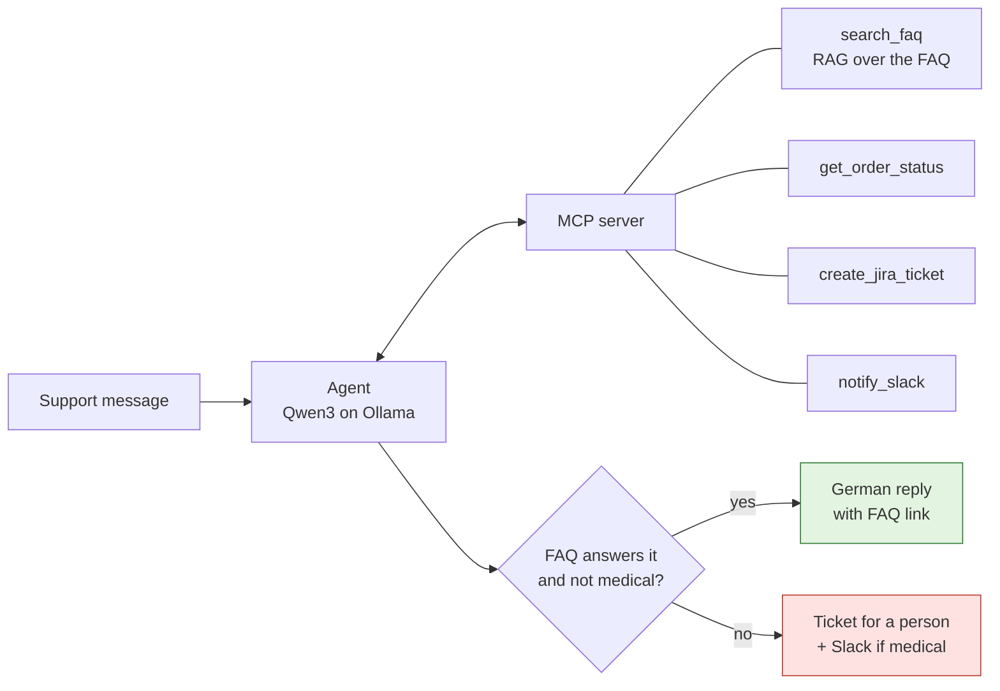

# mcp-support-triage-agent


<p align="center">
  <b>AI takeover</b> (of the boring support tickets)<br/><br/>
  
</p>

A prototype support assistant for the patient support team of a German telemedicine company. Many support messages ask the same things about delivery, prescriptions or payment, and some hide medical questions that must never get an automatic answer. To solve this, I built an MCP server with the tools the agent uses (FAQ search, order lookup, tickets and Slack) and connected a local LLM to the FAQ answers from Bloomwell's website through retrieval-augmented generation (RAG). The agent looks up the FAQ entries that match a message and writes its answer only from those. If the FAQ doesn't cover the question, or the question is medical, it hands the message to a person with a ticket.

**Data:** the FAQ is paraphrased from Bloomwell's public website (31 entries, each with its source link). The 100 support messages and the orders are invented, so no real patient data is used. The project is not affiliated with Bloomwell.

## How it works



For each message the agent:

1. sorts it into one of the categories from Bloomwell's support form
2. searches the FAQ and, if an order number is mentioned, looks up the order
3. answers in German with the FAQ source link if the FAQ covers the question
4. otherwise creates a ticket for the support team, and for medical questions also notifies a medical channel

Medical questions always go to a person. This is enforced in code as well as in the prompt.

The model (Qwen3) runs locally with Ollama, so messages never leave the machine. The tools (FAQ search, order lookup, ticket, Slack) sit behind a small MCP server, so the same tools also work with Claude Code. Tickets and Slack messages are simulated and written to `outbox/`. The tickets already use Jira's field format. Optional modes send tickets to a real Jira site and messages to Slack through a webhook, but neither has been tested with the real services yet.

## Run it

You need [uv](https://docs.astral.sh/uv/) and [Ollama](https://ollama.com). A GPU is optional but much faster.

```bash
git clone https://github.com/vpik009/mcp-support-triage-agent.git
cd mcp-support-triage-agent
uv sync
ollama pull qwen3:8b
uv run python -m src.agent
```

Then type a message, for example `Mein Paket BW-2026-49120 bewegt sich seit 9 Tagen nicht.`

To use the tools in Claude Code, start `claude` in the repo folder and approve the `bloomwell-support` server from `.mcp.json`.

For a real Jira test site, set `JIRA_URL`, `JIRA_EMAIL` and `JIRA_API_TOKEN` before starting. For Slack, set `SLACK_WEBHOOK_URL` to an incoming webhook. A webhook always posts to the same channel, so each message starts with the channel the agent picked.

## Results

`uv run python eval/run_eval.py dev` runs the agent on 30 labelled messages and checks its decisions, not the wording of its replies.

| Metric | qwen3:8b (local) | qwen3:4b (local) | Claude Opus 5.5 (cloud) |
|---|---|---|---|
| Category correct | 53 % | 60 % | TBA |
| Human needed: decided correctly | 70 % | 70 % | TBA |
| Ticket created exactly when needed | 70 % | 83 % | TBA |
| Medical questions sent to a person | 4 / 4 | 4 / 4 | TBA |
| Right FAQ entry used | 10 / 18 | 15 / 18 | TBA |
| Answered without a person | 17 % | 30 % | TBA |
| Time per message | 5.3 s | 39.3 s | TBA |

Aaaaaand the 4b model outperformed the 8b model...

<p align="center">
  
</p>

My guess: the 4b model calls the tools more often (which would also explain why it is about 7 times slower), so it sees more FAQ entries and order details before it decides. With only 30 messages, part of the gap may also be luck.

Every medical question reached a person with both models. The main error: in some cases the agent decided a person was needed but created no ticket. With 30 messages and one run per model, these numbers are a first impression. Details and planned fixes are in [eval/tests.md](eval/tests.md).

## Limitations

- The fixes from the evaluation are not applied yet.
- The Jira and Slack modes have not been tested with the real services.
- There is no pseudonymisation of personal data, which a cloud model would need.
